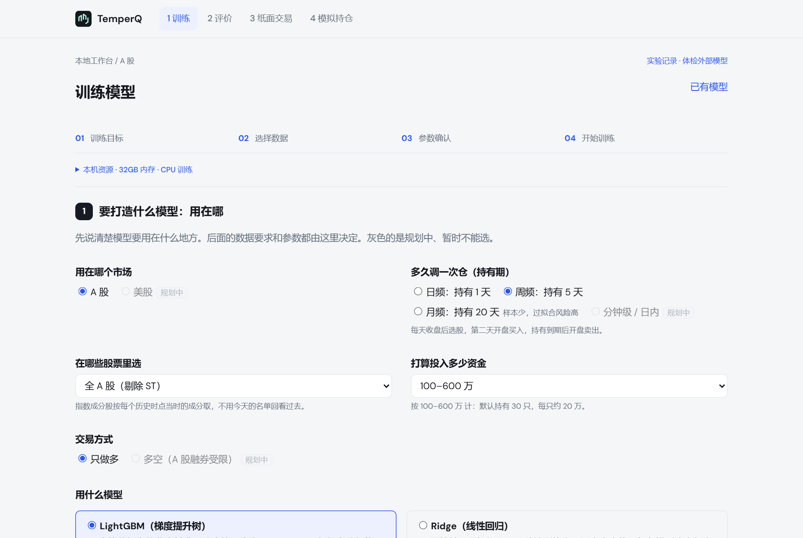
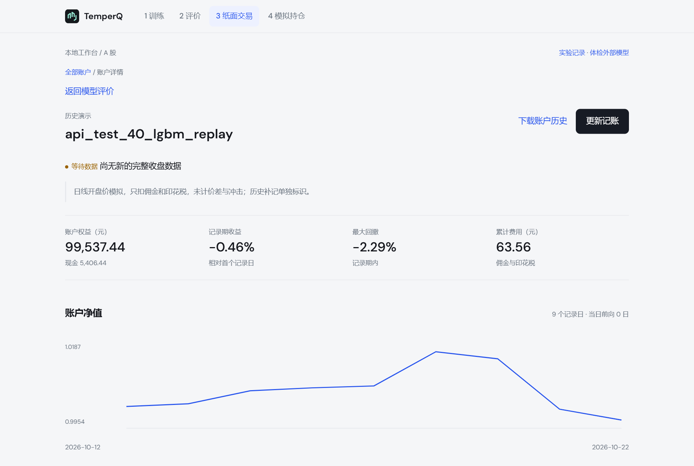

<div align="center">

# TemperQ

**Train your own model. Hold with clarity.**

English · [中文](README.md)

[](https://github.com/Dear-Huang/temperq/actions/workflows/ci.yml)
[](LICENSE)


</div>

TemperQ is a local workbench for building China A-share stock-selection models on your own machine. Without writing code, you can train a model on your own data, see what is left after trading costs, then connect the model to your holdings for daily trade suggestions and a paper ledger.

Most quant tools start from the model and stop at the backtest. TemperQ starts from your account: what you hold today, what to trade tomorrow, and what your account looks like after the fills.

<p align="center">
  
  
</p>

<p align="center"><sub>Left: training page. Right: paper account (a 40-stock historical demo, not strategy performance).</sub></p>

> The interface is currently in Chinese. English UI is planned.

## Why TemperQ

- **Your own model.** Train on your data, on your machine. Data and models never leave your computer.
- **A built-in reviewer.** Point-in-time data, look-ahead checks, simple baselines and net-of-cost tests are on by default. The first page of every report shows what remains after trading costs, not just flattering prediction metrics.
- **Down to your holdings.** T+1 settlement, board lots, minimum commissions, stamp duty, price limits and ST status are part of the design. Enter your cash and positions to get share-level buy and sell suggestions.
- **Keep iterating.** Every change creates a new version and old ones are kept. The evaluation tells you whether a difference exceeds random variation; you decide whether to switch.

## The four steps

| Step | What you do | What you get |
| --- | --- | --- |
| 1 Train | Pick market, holding period, universe and model (LightGBM / Ridge) | A trained model and a report |
| 2 Evaluate | Test on an independent benchmark | Whether predictive skill and net-of-cost excess return are supported by evidence |
| 3 Paper trade | Open a forward account with virtual cash | Daily equity, positions, fills and fees, recorded automatically |
| 4 Simulate holdings | Enter your real cash and a holdings CSV | A reference order list computed for your account |

## Quick start

Requires Windows 10/11 or Linux, Python 3.10+ and [uv](https://docs.astral.sh/uv/). LightGBM runs on CPU only, no GPU needed; 16 GB of RAM or more is recommended.

**Windows**

```powershell
git clone https://github.com/Dear-Huang/temperq.git
cd temperq
.\install.bat
.\start.bat
```

**Linux**

```bash
git clone https://github.com/Dear-Huang/temperq.git
cd temperq
sh install.sh
sh start.sh
```

Your browser opens `http://127.0.0.1:8765`. Choose the built-in sample data first; the first report appears in seconds.

The command line uses the same training pipeline as the web UI:

```bash
temperq run examples/run_smoke.yaml
```

## Data

TemperQ does not ship market data; bring your own licensed data. Three options:

- **CSV upload**: one row per stock per day with `code, date, open, high, low, close, amount`. A template is available on the page.
- **Tushare**: downloads automatically with your own token.
- **BaoStock (free)**: no registration or credits required. See the user manual (Chinese), section 9.

At least 3 years (720 trading days) of data is recommended. The UI tells you before training whether your data is sufficient.

## What it does not do

- It does not hold funds, connect to brokers or place orders.
- It does not recommend stocks, promise returns or rank strategies by return.
- The paper ledger currently charges commission and stamp duty only; bid-ask spread and market impact are not yet included, so results are optimistic.
- Passing a historical evaluation only means a model can start paper observation. It does not mean it will make money live.

## Documentation

Documentation is currently in Chinese:

- [User manual](docs/使用手册.md): installation, training, reading reports, paper trading, data
- [Product vision](docs/PRODUCT_VISION.md): why start from holdings
- [Common pitfalls](docs/PITFALLS.md): look-ahead, overnight gaps, treating IC as return
- [Development](docs/DEVELOPMENT.md): structure, tests, website and deployment

## Status

Early release (0.0.x); interfaces may change. Local training, independent evaluation, account suggestions and the daily paper ledger are in place. Real forward records have just started accumulating, and the project has not yet been tried by outside users. Feedback is welcome via [Issues](https://github.com/Dear-Huang/temperq/issues).

## License

Copyright © 2026 Dear-Huang. Licensed under [AGPL-3.0](LICENSE): you may use, modify and redistribute it; if you modify it and let others use it over a network, you must make your modified source available. The cost library in `third_party/ashare-tcost` is MIT-licensed and the fonts are SIL OFL 1.1; see [NOTICE](NOTICE).

For research and education only. Not investment advice.
