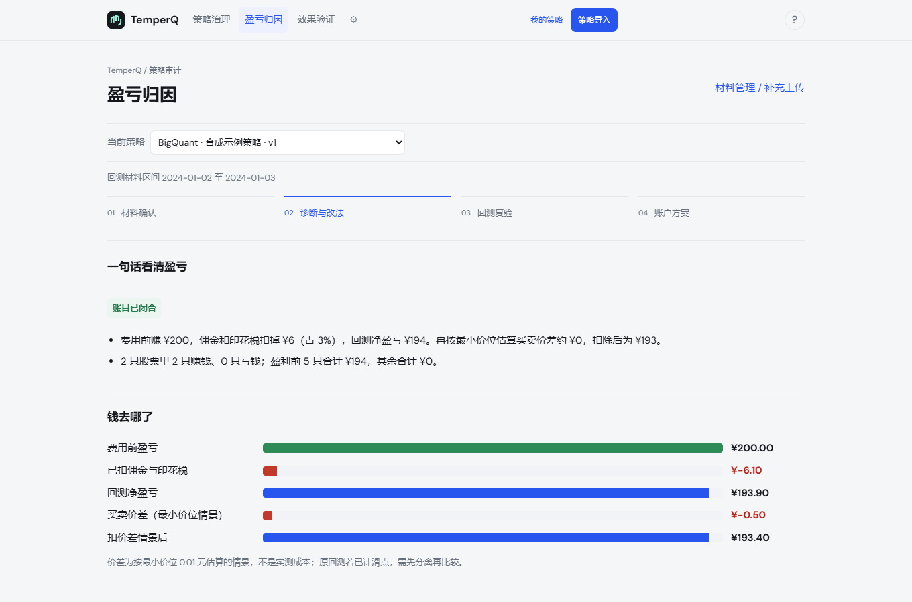

<div align="center">

# TemperQ

**你的回测，经得起审计吗？**

把平台导出的回测文件交给 TemperQ，拿回一份审计报告：<br>
收益能不能信、你的想法对不对、该改什么。

开源 · 本地运行 · 不执行你的代码 · 支持 BigQuant / 聚宽 / 米筐，其他平台可转格式

[English](README.en.md) · 中文

[](https://github.com/Dear-Huang/temperq/actions/workflows/ci.yml)
[](LICENSE)


[快速开始](#快速开始) · [能查出什么](#先看它能查出什么) · [导入格式](docs/STRATEGY_AUDIT_FORMAT.md) · [反馈](https://github.com/Dear-Huang/temperq/issues)

</div>

回测曲线很漂亮，但你真的知道它是怎么来的吗？费用扣对了没有，9:30 那一分钟真能按那个价成交吗，赚钱是因为你选的因子，还是因为这段时间所有标的都在涨？

TemperQ 只看回测的**输出**：成交、持仓、账户、日志和策略代码。它先把账逐日对平，再逐环节审计，最后给出一份能复算的报告。你的代码只被读取，从不运行。

## 先看它能查出什么

下面都是真实结果：把聚宽社区的公开策略迁到本地米筐，跑出回测，再交给 TemperQ 审计。

| 你以为 | 审计发现 |
| --- | --- |
| 一年赚了 4,318 元，策略有效 | 换个时点成交，盈亏变化从 −736 到 +9,215 元，波动比利润本身还大：**结论取决于你假设几点成交** |
| 回测里的动量因子在起作用 | 候选池只有 4 只 ETF，按现在的效果大小，大约要 9 年数据才能测出因子是否有效：**没测出不等于错了，但这段回测证明不了它** |
| 留 1% 现金、加个保留带，两个改进一起上 | 单独留现金多赚 0.71 个百分点，和保留带一起用反而少赚 3.80 个百分点：**两条建议不能叠加** |
| 买到了目标 ETF，执行没问题 | 一笔买单只成交了 30%，之后 71 个交易日没有补单，期间平均 67% 的钱闲在现金里：**持有了目标，不等于完成了买单** |
| 219 天没持有排名第一，执行出了问题 | 其中 193 天是策略自带的保留规则在起作用，真正的执行缺口只有 26 天：**不把策略本身的设计误判成故障** |
| 三年赚了 108.8%，换仓都很顺 | 43 次换仓的买入要靠同一分钟卖出的钱才付得起，回测默认卖单先成交、钱马上到账。改成按下一根分钟线撮合重跑，这个依赖消失，收益变为 87.1%：**收益里有一块来自理想的资金衔接** |

米筐 10 个策略的一年回测，审计复算的区间收益、最大回撤、基准收益与米筐自报的数字逐一对得上（夏普比率不同，因为米筐扣了无风险利率，报告会注明）。

## 报告长什么样

报告开头只回答三个问题：

<table>
<tr>
<td width="33%" valign="top"><b>收益能信吗</b><br><sub>账对不对得上、与平台自报是否一致、帖子声称的收益能否复现、换个时点成交会怎样、扣掉买卖价差还赚不赚</sub></td>
<td width="33%" valign="top"><b>你的想法对吗</b><br><sub>从代码和选股行为识别你依据的因子，检验它对不对、对多少、哪段时间对；没测出时说清是样本不够还是确实不成立</sub></td>
<td width="33%" valign="top"><b>该改什么</b><br><sub>最多三条，每条指到代码第几行，写明能省什么、要放弃什么、什么情况下这条建议不成立</sub></td>
</tr>
</table>

后面是七节正文：结论摘要、策略前提检验、收益与风险（含与平台自报数字对照）、盈亏归因、成本与执行、发现与建议、审计范围与限制。报告最后会明确列出**哪些环节审了，哪些因为缺材料没审、补什么能审**。没审到的不代表没问题，报告不会假装审过。

<p align="center">
  
</p>
<p align="center"><sub>盈亏归因页。使用内置合成示例，仅展示界面，不代表投资表现。</sub></p>

## 为什么可以信这份报告

- **先对账，再下结论。** 每天核对：权益 = 现金 + 市值，持仓变化 = 成交，现金变化 = 成交金额 + 费用。账对不平的环节只标"待核对"，不出结论。
- **每个数字都能复算。** 报告附带全部输入、中间结果和逐笔明细，带输入与结果的哈希。同一份材料，任何时候重跑都得到同一份报告。
- **判断有出处。** 交易所规则、税率、统计方法和经验阈值分开登记，每条建议注明依据哪几条；经验阈值标明"未经样本检验"，可以自己调。见 [审计规则](docs/AUDIT_RULES.md)。
- **证据分等级。** 账目复算、事后描述、情景估计、同区间复跑，各自标注，不把情景当事实，也不把样本内当样本外。
- **报告不由 AI 写。** 即使用 AI 版，报告也由审计引擎生成；AI 只负责转格式和转述，不能加自己的评价。

## 两种用法

| | 本地网页版 | AI 版（skill） |
| --- | --- | --- |
| 适合 | 不想让任何材料离开电脑 | 材料五花八门，懒得整理格式 |
| 材料 | BigQuant、聚宽、米筐原始导出直接拖进来；其他平台按 [通用格式](docs/STRATEGY_AUDIT_FORMAT.md) 整理 | 什么格式都行，AI 看表头写转换脚本 |
| 谁出报告 | 审计引擎 | 同一个审计引擎，报告完全相同 |
| 数据去向 | 全程在本机 | 审计在本机运行；文件表头和前几行会发给模型 |

AI 版放在 [`skills/strategy-audit/`](skills/strategy-audit/SKILL.md)。AI 转完格式后必须先用引擎对账，账对不上就说明转错了，要重转。

在 Claude Code 里使用：先按下面的快速开始装好 TemperQ，再把 `skills/strategy-audit` 整个文件夹复制到 `~/.claude/skills/`（所有项目可用）或你项目的 `.claude/skills/`，然后对 Claude 说"帮我审计这个回测"，并给出导出文件所在的目录。

## 想检验更多？补两份材料

平台默认不导出这两份材料，补上后能多做两项检验：

- **每日打分**（检验你的因子是否有效）：把 [`temperq_recorder.py`](src/qwb/static/temperq_recorder.py) 粘进策略副本，加一行 `temperq_record(context, 分数, 选中)`，回平台重跑一次。`qwb audit instrument-check` 会证明副本除记录语句外与原策略完全一样。
- **候选池收盘价和成交日分钟价**（检验因子、检验成交时点）：在平台研究环境运行 [`temperq_supplement.py`](src/qwb/static/temperq_supplement.py)。

## 改了值不值

报告给出改法后，回平台改代码重跑，把新的导出再审一次：

- `qwb audit compare <原版> <改版>`：按同一口径比较两版，给出更好、有得有失或更差。两版交易完全相同时，会指出差异只来自费用。
- `qwb audit interaction <原版> <只改A> <只改B> <都改>`：判断两条建议能不能一起用。

同区间复跑仍是样本内比较，报告会写明。

## 快速开始

支持 **Windows 10/11、Linux**，CPU 即可，建议 8GB 以上内存。首次安装需要联网，脚本会准备独立的 Python 3.11 环境，不影响电脑上已有的 Python。

### Windows

1. 安装 [uv](https://docs.astral.sh/uv/getting-started/installation/)，装好后重新打开终端。
2. [下载源码 ZIP](https://github.com/Dear-Huang/temperq/archive/refs/heads/main.zip) 并完整解压。
3. 双击 `install.bat`，等待安装和自检完成。
4. 双击 `start.bat`，浏览器会打开本地工作台。点「策略导入」，可以先用「下载合成示例」走一遍。

### 命令行

```powershell
.venv\Scripts\qwb audit check D:\我的回测导出              # 读成了什么、账对不对得上
.venv\Scripts\qwb audit run   D:\我的回测导出 --out D:\审计结果  # 生成 report.html 等
```

`report.html` 用浏览器打开，可以直接打印成 PDF。可选参数：`--commission-bp`（券商合同佣金）、`--premise-text`（你自己说的策略前提）、`--claimed-total`（帖子声称的累计收益，用于对照）等，见 `qwb audit run --help`。

<details>
<summary>使用 Git 安装 / Linux 安装</summary>

**Windows**（先安装 uv 和 Git）：

```powershell
git clone https://github.com/Dear-Huang/temperq.git
cd temperq
.\install.bat
.\start.bat
```

**Linux**（需要 Git、curl，脚本会按需安装 uv）：

```bash
git clone https://github.com/Dear-Huang/temperq.git
cd temperq
sh install.sh
sh start.sh
```

默认地址 `http://127.0.0.1:8765`，以启动窗口显示为准。排错见 [使用手册](docs/使用手册.md)。

</details>

## 支持哪些平台

| 平台 | 怎么交材料 |
| --- | --- |
| BigQuant | 回测结果页导出交易、持仓、日志，加策略代码，原样上传 |
| 聚宽 | 导出交易详情、持仓，加策略代码；ZIP 不用解压 |
| 米筐 | 网页导出交易、持仓、账户详情，或本地 RQAlpha 原生报告，加策略代码 |
| 掘金、QMT、PTrade、自研回测等 | 按 [通用格式](docs/STRATEGY_AUDIT_FORMAT.md) 整理成 trades / holdings / account 三个 CSV，或交给 AI 版转换 |

只覆盖 A 股股票、ETF/基金和可转债，只做多；期货、期权和北交所暂不支持。

## 隐私与安全

- 策略代码只做 Python AST **只读解析**，从不导入、从不执行。
- 本地网页版的所有文件和报告保存在你自己的电脑上，不上传到任何服务器。
- 工作台只监听本机地址（`127.0.0.1`）。

## 口径与边界

- 买卖价差按最小报价单位估计下限，**大单冲击成本尚未计入**。资金规模大、交易小盘股的策略，真实成本会更高。
- 成交时点检验只换成交价，不重跑策略决策；推断的分红送转会列出来，请你确认。
- 所有结论只描述这段历史回测，不预测未来收益。本项目用于研究与学习，不构成投资建议。

<details>
<summary>其他保留功能：模型训练、账户诊断与纸面跟踪</summary>

早期版本的可视化训练（LightGBM / Ridge）、账户调整诊断、历史回放和本机纸面账户仍然保留，可从工作台设置进入。见 [我的策略指南](docs/STRATEGY_WORKSPACE.md) 和 [治理工作台指南](docs/GOVERNANCE_REVIEW.md)。

</details>

## 文档与参与

- [策略审计导入格式](docs/STRATEGY_AUDIT_FORMAT.md)：各平台怎么导出、通用格式字段。
- [审计规则](docs/AUDIT_RULES.md)：每条规则、方法和阈值的出处。
- [为什么这样设计](docs/WHY_THIS_DESIGN.md)：为什么只审输出、不跑代码、不比收益。
- [常见陷阱](docs/PITFALLS.md)：前视、隔夜跳空、把预测指标当收益等。
- [开发说明](docs/DEVELOPMENT.md)：项目结构、测试与开发环境。

TemperQ 仍在早期版本。拿你自己的回测来试一试吧；查出问题、看不懂报告、或者觉得哪里判断错了，都欢迎 [提 issue](https://github.com/Dear-Huang/temperq/issues)。你的平台还不支持的话，附一份脱敏的导出表头，我们会优先适配。

## 近期优化（2026 年 10 月）

这一轮的改动来自多次独立复核：用 RiceQuant、聚宽的真实策略端到端跑审计，再由另一方逐项核对报告。改动集中在一件事上：**审计不再把自己推断的东西当成事实**，拿到明确材料就用材料，拿不到就说明没读到。

新增的检查：

- **收益对应的是不是声明的策略**：逐标的逐日盈亏，按前一日收盘是否在策略目标内分组。一个轮动案例里，37% 的净盈利来自已在目标外的持仓。这是会计分组，不从收益里扣，也不预测修正后的收益。
- **隔夜暴露**：收盘仍有持仓的天数，以及收盘到次日开盘的盈亏。声明日内清仓的策略可以据此核对。
- **资金能否兑现配置**：用整数规划求整手下目标权重的最小偏离（乐观下界）。下界超过容忍度即证明这个本金做不到；下界小不证明做得到。
- **目标权重兑现**：可选材料 `target_weights.csv`，比较收盘实际权重与目标，并标出一手以内、凑不齐整手的缺口。
- **"买第一名"单独检验**：全排名 IC 之外，加一项排第一的标的相对候选池的收益和 t 值。两者回答不同问题。
- **卖单没卖掉、长期空仓**：没成交完的卖单和之后仍持有的天数；既无成交也无持仓的最长连续天数（日内策略收盘空仓不算空闲）。

修正的判断：

- 每日打分全部 `selected=false` 视为空仓目标，不再自动补上第一名；有明确目标时，不再推断"保留规则"来豁免偏离。
- 零成交的补单不算补上；部分成交后长期未补会单独报告。
- 收盘持有目标以外的标的、策略选了空仓却仍有持仓，都会计数。
- 分红送转按持股记录、T+1 权益类 ETF 不当日回转、平台默认费率、全部盈利时写"贡献最少"而不是"亏得最多"等口径修正。

每条规则和阈值的出处见 [审计规则](docs/AUDIT_RULES.md)。

## 许可

项目代码采用 [AGPL-3.0](LICENSE) 许可，版权所有 Dear-Huang。第三方组件遵循各自许可，见 [NOTICE](NOTICE)。
