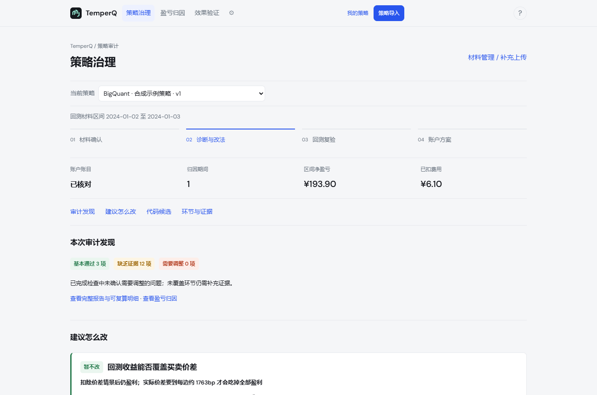

<div align="center">

# TemperQ

**你的回测赚的钱，有多少是真的？**

开源 · 本地运行 · 不执行你的代码 · 支持 BigQuant / 聚宽 / 米筐

[English](README.en.md) · 中文

[](https://github.com/Dear-Huang/temperq/actions/workflows/ci.yml)
[](LICENSE)


[快速开始](#快速开始) · [导入格式](docs/STRATEGY_AUDIT_FORMAT.md) · [反馈与建议](https://github.com/Dear-Huang/temperq/issues)

</div>

TemperQ 是 A 股日频策略的**本地回测审计工具**。你在 BigQuant、聚宽或米筐上写好策略、跑完回测，把平台导出的原始文件拖进来，TemperQ 会把账逐笔对平，告诉你：费用扣得对不对、买卖价差吃掉多少、钱是哪几只股票赚的，以及该改什么、改了值不值。

它只审计回测的**输出**，不运行你的策略代码，也不替代你用的平台。

<p align="center">
  
</p>

<p align="center"><sub>策略治理页。使用内置合成示例，仅展示界面，不代表投资表现。</sub></p>

## 三步看清一个回测

| 页面 | 回答什么 | 你会看到 |
| --- | --- | --- |
| **策略治理** | 这个回测哪里不对、该怎么改 | 每个问题一张卡片：发现、可选改法（总含"维持原样"）、省下多少、可能放弃什么、证据强弱、什么情况下结论会被推翻 |
| **盈亏归因** | 钱是怎么赚的、怎么亏的 | 费用前盈亏 → 佣金印花税 → 回测净盈亏 → 价差情景的瀑布；盈亏集中在哪几只股票、哪个持有期、哪个价格段；最大回撤由谁造成 |
| **效果验证** | 改了以后是不是真的更好 | 先按真实成本重算原回测；再把优化版在原平台重跑、导出上传，按全区间和内部验证段对比，给出"更好 / 有得有失 / 更差" |

<p align="center">
  
</p>

## 为什么可以信这份审计

- **先对账，再下结论。** 每天核对：权益 = 现金 + 市值，持仓变化 = 成交，现金变化 = 成交金额 + 费用，盈亏能逐日闭合。账对不平的环节只标"待核对"，不出结论。
- **费用按当日规则重算。** 佣金、最低佣金、印花税按成交日期的真实税率复算，和平台报出的费用逐笔比对。
- **价差用可复核的下限。** A 股最小价位 0.01 元，每边至少付半个价位：`半价差(bp) = 10000 × 0.01 / (2 × 价格)`。低价股、高换手的策略，这一项往往比佣金还大。这是情景估计，不是实测成交成本，页面会明确标出。
- **推断的都标出来。** 只有持仓没有成交时，交易由持仓反推；聚宽、米筐不导出分红送转，TemperQ 从现金和股数的变化识别，页面列为"由账户推断"，请你确认。
- **改法可以被检验。** 建议不止于文字：BigQuant 策略可生成优化代码，你在原平台重跑后上传，用同一把尺子比对前后。

## 支持哪些平台

| 平台 | 上传什么 | 能做到 |
| --- | --- | --- |
| **BigQuant** | 回测页导出的「交易」「持仓」「日志」+ 策略代码 | 完整审计；可生成优化代码 |
| **聚宽** | 回测页导出的「交易详情」「持仓」+ 策略代码 | 完整审计；分红送转由账户推断；文字建议 |
| **米筐** | 回测页导出的「交易详情」「持仓详情」「账户详情」+ 策略代码 | 完整审计；分红送转由账户推断；文字建议 |
| **其他平台** | 按 [通用格式](docs/STRATEGY_AUDIT_FORMAT.md) 整理的 trades / holdings / account | 费用、价差、归因；代码只读取明显参数 |

原始文件**直接上传，不用改格式**，平台按表头自动识别；不同平台的文件不能混在一次回测里。三个平台都已用真实回测导出跑通账目闭合。

每日打分不是必需的。三个平台都不方便导出全部候选股的每日打分，1.0 的全部审计都不依赖它；能提供时，可额外分析信号能管几天。

## 隐私与安全

- 策略代码只用 Python AST **只读解析**，从不导入、从不执行。
- 所有文件和报告保存在你自己的电脑上，不上传到任何服务器。
- 工作台只监听本机地址（`127.0.0.1`）。

## 快速开始

支持 **Windows 10/11、Linux**，CPU 即可，建议 8GB 以上内存。首次安装需要联网，脚本会准备独立的 Python 3.11 环境。

### Windows

1. 安装 [uv](https://docs.astral.sh/uv/getting-started/installation/)，装好后重新打开终端。
2. [下载源码 ZIP](https://github.com/Dear-Huang/temperq/archive/refs/heads/main.zip) 并完整解压。
3. 双击 `install.bat`，等待安装和自检完成。
4. 双击 `start.bat`，浏览器打开本地工作台。使用期间保持启动窗口开启。

<details>
<summary>使用 Git 安装 / Linux 安装</summary>

**Windows**（先安装 uv 和 Git）：

```powershell
git clone https://github.com/Dear-Huang/temperq.git
cd temperq
.\install.bat
.\start.bat
```

**Linux**（需要 Git、curl，脚本会按需安装 uv）：

```bash
git clone https://github.com/Dear-Huang/temperq.git
cd temperq
sh install.sh
sh start.sh
```

默认地址 `http://127.0.0.1:8765`，以启动窗口显示为准。排错见 [使用手册](docs/使用手册.md)。

</details>

### 第一次用

1. 点「策略导入」，选「下载合成示例」，原样上传，走一遍三个页面。
2. 到你常用的平台打开一次回测，按上表导出文件，连同策略代码一起拖进来。
3. 在材料确认页看清识别结果和推断项，确认是同一次回测，进入策略治理。
4. 按卡片建议修改策略，在原平台重跑，回到「效果验证」上传优化版对比。

## 口径与边界

- 价差情景只计最小价位带来的下限，**大单冲击成本尚未计入**。资金规模大、交易小盘股的策略，真实成本会更高。
- 推断的分红按前一日市值分摊到当日持仓，是估计；平台有公司行动记录时以原记录为准。
- 归因与验证只说明这段历史回测里发生了什么，不预测未来收益。本项目用于研究与学习，不构成投资建议。

<details>
<summary>其他保留功能：模型训练、账户诊断与纸面跟踪</summary>

早期版本的可视化训练（LightGBM / Ridge）、账户调整诊断、历史回放和本机纸面账户仍然保留，可从工作台设置进入。使用方法见 [我的策略指南](docs/STRATEGY_WORKSPACE.md) 和 [治理工作台指南](docs/GOVERNANCE_REVIEW.md)。

</details>

## 文档与参与

- [策略审计导入格式](docs/STRATEGY_AUDIT_FORMAT.md)：各平台怎么导出、通用格式字段、能拿到什么。
- [为什么这样设计](docs/WHY_THIS_DESIGN.md)：为什么只审输出、不跑代码、不比收益。
- [常见陷阱](docs/PITFALLS.md)：前视、隔夜跳空、把预测指标当收益等。
- [开发说明](docs/DEVELOPMENT.md)：项目结构、测试与开发环境。

TemperQ 仍在早期版本。欢迎[报告问题、提出需求](https://github.com/Dear-Huang/temperq/issues)；如果你用的平台还不支持，附上一份脱敏的导出表头，我们会优先适配。

## 许可

项目代码采用 [AGPL-3.0](LICENSE) 许可，版权所有 Dear-Huang。第三方组件遵循各自许可，见 [NOTICE](NOTICE)。
